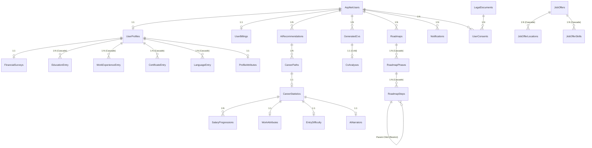

# 🗺️ Vocare — Comprehensive Project Map & Architecture Guide

> **Version:** 1.0  
> **Last Updated:** 2026-09-12  
> **Purpose:** Architectural guide and navigation map for AI agents and software engineers building the Vocare platform.

---

## 1. 🎯 Business Domain & Platform Services

**Vocare** is an AI-powered career development platform. It integrates AI candidate profile analysis, resume creation, tailoring, and quality auditing, career path predictions, interactive roadmaps, and semantic job offer matching.

### 🌟 Core Platform Services:

1. **AI Career Advisor**
   - Analyzes user technical and soft skills, education, work experience, and financial expectations.
   - Recommends optimal career paths (`CareerPath`) complete with rationale and labor market analysis.
   - Market statistics: salary progression (Junior → Mid → Senior → Lead), entry difficulty/barriers, missing skill gaps, market demand, and work attributes (stress level, work-life balance, remote work availability).
   - AI Narrator (`AiNarrator`): generates a personalized narrative summary of the user's career situation.
   - *Token Costs:* `AnalyzeProfile` (60 tokens), `MarketAnalysis` (50 tokens).

2. **CV Generator, Tailoring & Quality Analysis**
   - Multi-version CV management: manages multiple CV versions (`GeneratedCv`), default CV designation, active/archive lifecycle flags.
   - CV PDF parser (`PdfPig`): extracts profile data from uploaded PDF resumes to autofill user profiles.
   - Profile-based CV generation (`GenerateCvFromProfile`, 20 tokens).
   - Job-tailored CV customization (`TailorCv`, 20 tokens): adapts resume content to match a specific job description.
   - AI CV Quality Audit (`AnalyzeCv`, 10 tokens): overall score (0–100), target position alignment score, scoring and actionable recommendations across 8 sections (`Basics`, `Work`, `Education`, `Certificates`, `Skills`, `Languages`, `Projects`, `Social`), plus top 3 highest-priority improvements.
   - PDF export supporting multiple styling templates.

3. **Career Roadmap**
   - Generates phased career progression plans across a customizable time horizon (e.g., 6, 12, 24 months).
   - Visualized as an interactive 2D graph (nodes and edges rendered on a React Flow canvas).
   - Two-level hierarchy: Phases (`RoadmapPhase`) and Steps (`RoadmapStep`) with topics (`Topics` stored as PostgreSQL `jsonb`), status (`NotStarted`, `InProgress`, `Completed`), and requirement type (`Required`, `Optional`).
   - Asynchronous background generation powered by Hangfire.

4. **Job Offers Matching & Semantic Search**
   - Automated scraping and synchronization of job postings from external portals (including SolidJobs).
   - PostgreSQL `pgvector`: 1536-dimensional OpenAI embeddings (`text-embedding-3-small`) for job postings, career paths, and normalized skills (`SkillEmbedding`).
   - Semantic scoring and candidate matching: skill vector cosine distance, job category filtering, location, and salary brackets.
   - Dedicated recommendation endpoints integrated with user career paths.

5. **Market News & Blog**
   - Weekly AI-generated reports and editorial articles tracking IT and labor market trends.
   - Displayed via a homepage banner/modal, a 3-item latest news widget, and a dedicated paginated blog.

6. **Billing & Subscriptions**
   - Hybrid monetization model: recurring Stripe subscription plans + one-time pay-as-you-go token packs.
   - Service cost schedule (`ServiceCosts` table) strictly controlling token consumption per AI action.
   - Stripe integrations: Checkout Sessions, Customer Portal (card updates, plan upgrades, cancellations), and webhooks with signature verification and rate limiting.

7. **Legal Consent Management ("Hard Wall" GDPR/RODO)**
   - Versioned legal documents (`LegalDocuments`: Terms of Service, Privacy Policy).
   - Granular user consent audit log (`UserConsents`: IP address, User-Agent, timestamp, consent source).
   - "Hard Wall" middleware (`LegalConsentsMiddleware`): authenticated users whose token lacks `consents_valid == true` are blocked with HTTP 403 `CONSENTS_REQUIRED` across all business endpoints until current legal documents are accepted.

8. **Notification Center**
   - In-app notification feed alerting users on roadmap generation completion, newly matched job offers, and system events.

---

## 2. 🛠️ Tech Stack, Tools & Libraries

### Backend (.NET Core / C#)
| Category | Technology / Library | Version / Notes |
| :--- | :--- | :--- |
| **Framework** | .NET 9 (C# preview) | `Microsoft.NET.Sdk.Web` |
| **ORM & Database** | Entity Framework Core, Npgsql | EF Core 9.0.3, Npgsql 9.0.4 |
| **AI Vectors** | `Pgvector`, `Pgvector.EntityFrameworkCore` | 1536-dimensional embeddings |
| **Background Jobs** | `Hangfire.AspNetCore`, `Hangfire.PostgreSql` | Version 1.8.23, PostgreSQL storage |
| **Authentication** | ASP.NET Identity, DataProtection Tokens | Custom bearer token, Google OAuth, LinkedIn OAuth |
| **AI Integrations** | OpenAI API (`HttpClient`), Perplexity AI | Chat completions, embeddings (`text-embedding-3-small`) |
| **Billing** | `Stripe.net` | Version 48.0.0, webhooks, checkout sessions, customer portal |
| **HTTP Resilience** | `Polly`, `Microsoft.Extensions.Http.Polly` | Retry policies, exponential backoff, circuit breaker |
| **PDF Extraction** | `PdfPig` | Text and structure extraction from uploaded resumes |
| **API Docs** | `Swashbuckle.AspNetCore` | Swagger UI at `/swagger` (Dev/Staging) |
| **Security Headers**| `NetEscapades.AspNetCore.SecurityHeaders` | CSP, HSTS, X-Frame-Options |
| **Email** | `Resend` | Transactional emails (password reset, account notifications) |
| **Object Mapping** | `AutoMapper` | Version 14.0.0 |
| **C# Formatter** | `csharpier` | dotnet tool (`0.30.6`) |

### Frontend (Next.js / React / TypeScript)
| Category | Technology / Library | Version / Notes |
| :--- | :--- | :--- |
| **Framework** | Next.js 16 (App Router), React 19.1.0 | Server Components by default, Server Actions |
| **Language** | TypeScript 5 | Strict typing, path aliases (`@/*`) |
| **Styling** | Tailwind CSS v4, PostCSS | `@tailwindcss/postcss`, `tw-animate-css` |
| **UI Components** | Radix UI primitives, `shadcn/ui` | Dialog, Dropdown, Tooltip, Select, Sheet, etc. |
| **Animations & 3D** | Framer Motion / `motion`, GSAP, Three.js | `@react-three/fiber`, `@splinetool/react-spline` |
| **Graphs / Canvas** | `@xyflow/react` (React Flow), `dagre` | Interactive Career Roadmap 2D node canvas |
| **Forms & Validation**| `react-hook-form`, `zod`, `@hookform/resolvers` | Client and server validation schemas |
| **Result Pattern** | `neverthrow` | `Result<ApiResponse<T>, ApiError>`, functional error handling |
| **PDF Rendering** | `@react-pdf/renderer`, `jspdf`, `html2canvas` | In-browser CV export and rendering |
| **Charts & Feedback**| `recharts`, `sonner` (toasts), `canvas-confetti` | Analytics charts and interactive feedback |
| **Smooth Scroll** | `lenis`, `@studio-freight/lenis` | Marketing page smooth scrolling |
| **Testing** | `vitest`, `@testing-library/react`, `jsdom` | Unit and component integration tests |
| **Linting & Rules** | ESLint 9 (flat config), Prettier + Tailwind | Husky git hooks |

### Mobile (Flutter)
- Located in `/mobile`.
- Cross-platform Android & iOS application written in Dart.

### Infrastructure & Deployment
- **Backend:** Railway (`railway.toml`, `Dockerfile`, dynamic port binding via `$PORT`, database migration loop with retry resilience).
- **Frontend:** Vercel (Next.js SSR, Edge / Node runtime).
- **Database:** Managed PostgreSQL instance on Railway with the `vector` extension enabled.
- **CI/CD:** GitHub Actions (`pr-tests.yml`, `release-please.yml` for Conventional Commits).

---

## 3. 📂 Project Directory Structure

```text
Vocare/
├── .agents/                    # Agent customizations (rules, skills, instructions)
│   ├── instructions/           # Long-form architectural references (project-map.md, cv-quality-audit-design.md)
│   └── skills/                 # Procedural runbooks (scaffolding, DAL, pgvector, etc.)
├── .config/                    # .NET tools manifest
├── .github/                    # GitHub Actions workflows & PR templates
├── .husky/                     # Git hooks (pre-commit lint-staged)
├── .instructions/              # Legacy planning & architectural notes
├── package.json                # Root tooling scripts (formatting, linting, husky)
├── railway.toml                # Railway deployment configuration
├── vocare_backup.sql           # Database schema & reference data backup
│
├── VocareWebAPI/               # 🚀 BACKEND APPLICATION (.NET 9)
│   ├── Billing/                # Slice: Payments, Stripe, token balance, subscriptions
│   │   ├── Configuration/      # Token packages and subscription configuration
│   │   ├── Controllers/        # BillingController
│   │   ├── Exceptions/         # Domain-specific billing exceptions
│   │   ├── Models/             # Billing entities, DTOs
│   │   ├── Repositories/       # Data access (UserBilling, TokenTransaction, ServiceCost)
│   │   └── Services/           # StripeService, BillingService
│   ├── CareerAdvisor/          # Slice: AI career advisor & market analysis
│   │   ├── Controllers/        # AiController, MarketAnalysisController
│   │   ├── Models/             # Recommendations, career path entities, DTOs
│   │   ├── Repositories/       # Career paths, trends, narrator repositories
│   │   └── Services/           # OpenAIService, OpenAiMarketAnalysisService, PerplexityAiService
│   ├── CvGenerator/            # Slice: CV management, AI quality audit & tailoring
│   │   ├── Controllers/        # CvController
│   │   ├── Models/             # GeneratedCv, CvAnalysis entities and DTOs
│   │   ├── Repositories/       # GeneratedCvRepository, CvAnalysisRepository
│   │   └── Services/           # CvManagementService, CvAnalysisService, CvTailoringService
│   ├── DevEmails/              # Development email preview templates
│   ├── Extensions/             # Dependency injection & middleware pipeline extensions
│   │   ├── ApplicationBuilderExtensions/ # CORS, logging, security headers, legal middleware
│   │   └── ServiceCollectionExtensions/  # DB, auth, Hangfire, HTTP resilience, rate limiting
│   ├── JobOffers/              # Slice: Job scraping, pgvector embeddings & matching
│   │   ├── BackgroundJobs/     # Hangfire / IHostedService sync jobs
│   │   ├── Controllers/        # JobOffersController, CronController
│   │   ├── ExternalClients/    # SolidJobs client & API models
│   │   ├── Models/             # JobOffer, SkillEmbedding entities and matching DTOs
│   │   ├── Repositories/       # Job offers, vector embeddings, location repositories
│   │   └── Services/           # MatchingService, SkillEmbeddingService, SyncService
│   ├── Legal/                  # Slice: GDPR/RODO legal consent management
│   │   ├── Controllers/        # LegalController
│   │   ├── Middlewares/        # LegalConsentsMiddleware ("Hard Wall")
│   │   ├── Models/             # LegalDocument, UserConsent entities
│   │   ├── Repositories/       # LegalRepository
│   │   └── Services/           # LegalService
│   ├── MarketNews/             # Slice: Weekly AI labor market intelligence
│   │   ├── Controllers/        # MarketNewsController
│   │   ├── Models/             # MarketNewsEntity, DTOs
│   │   └── Services/           # MarketNewsService, MarketNewsBackgroundService
│   ├── Migrations/             # EF Core migrations (AppDbContextModelSnapshot)
│   ├── Notifications/          # Slice: In-app user notification center
│   │   ├── Controllers/        # NotificationController
│   │   └── Services/           # NotificationService
│   ├── RoadmapService/         # Slice: Phased career roadmap generation
│   │   ├── Controllers/        # RoadmapController, RoadmapPhasesController, RoadmapStepsController
│   │   ├── Jobs/               # Asynchronous RoadmapGenerationJob (Hangfire)
│   │   ├── Models/             # Roadmap, RoadmapPhase, RoadmapStep entities
│   │   └── Services/           # CareerRoadmapService, RoadmapGeneratorService
│   ├── Shared/                 # Shared backend kernel & cross-cutting components
│   │   ├── Data/               # AppDbContext (Main EF Core DbContext)
│   │   ├── Exceptions/         # Global domain exceptions & exception handling
│   │   ├── Models/             # Shared models (OpenAIConfig, PaginatedResult)
│   │   ├── Results/            # Result pattern implementation for C#
│   │   └── Services/           # OpenAIEmbeddingService, EmailService
│   ├── UserManagement/         # Slice: Users, profiles, auth, onboarding
│   │   ├── Controllers/        # AuthController, DashboardController, MarketingController, UserProfileController
│   │   ├── Models/             # User, UserProfile, ProfileAttributes, DTOs
│   │   └── Services/           # AuthenticationService, UserProfileService, DashboardService, CvParserService
│   └── Program.cs              # Entry point, middleware pipeline, port binding, DB retry loop
│
├── VocareWebApi.Tests/         # Backend unit and integration test suite
│
├── frontend/                   # 💻 FRONTEND APPLICATION (Next.js 16 + React 19)
│   ├── app/                    # Next.js App Router (pages and layouts)
│   │   ├── (auth)/             # Route group: Login, Register, Forgot/Reset Password
│   │   ├── (marketing)/        # Route group: Landing page, About, Legal pages
│   │   ├── api/oauth/          # Route handlers: OAuth callbacks
│   │   ├── blog/               # Market news & article reader
│   │   ├── dashboard/          # Authenticated user hub (overview, recommendations)
│   │   ├── pricing/            # Token packages & subscription purchase
│   │   ├── resume/             # CV Builder, version list, AI audit panel
│   │   ├── roadmap/            # Interactive Career Roadmap canvas view
│   │   ├── layout.tsx          # Root application layout (Providers, ThemeProvider)
│   │   └── globals.css         # Theme design tokens & Tailwind CSS v4 setup
│   ├── components/             # Reusable UI component library (shadcn/ui primitives)
│   ├── features/               # 🧩 Business feature modules (Feature-Driven Architecture)
│   │   ├── assistant/          # AI chat assistant components
│   │   ├── auth/               # Login/register forms, session state
│   │   ├── billing/            # Stripe Checkout, token balance widgets, history
│   │   ├── blog/               # Market news cards & views
│   │   ├── dashboard/          # Metric cards, career widgets, user overview
│   │   ├── legal/              # Hard Wall consent acceptance modal
│   │   ├── market-analysis/    # Market analysis charts & salary progression
│   │   ├── marketing/          # Landing sections (Hero, Bento Grid, Testimonials)
│   │   ├── profile/            # Profile editor, financial survey, CV upload
│   │   ├── resume/             # CV editor, live preview, audit report
│   │   │   └── dal/            # Data Access Layer: queries, commands, api, services
│   │   └── roadmap/            # React Flow custom nodes, phase/step controllers
│   ├── hooks/                  # Global React hooks
│   ├── lib/                    # Shared frontend utilities
│   │   ├── api/api-client.ts   # Central HTTP client (neverthrow, cookies, fetch)
│   │   ├── env/                # Environment variable schema validation (T3 Env)
│   │   ├── tags.ts             # Centralized Next.js cache revalidation tags
│   │   └── types/              # Common TypeScript types (Result, Errors)
│   └── proxy.ts                # Auth middleware protecting private routes
│
└── mobile/                     # 📱 MOBILE APPLICATION (Flutter)
    ├── android/ & ios/         # Native platform configurations
    ├── lib/                    # Flutter Dart source code (views, state, services)
    └── pubspec.yaml            # Flutter package dependencies
```

---

## 4. 🗄️ Database Model (PostgreSQL + pgvector)

The database operates on the `public` PostgreSQL schema with the `vector` extension enabled (`builder.HasPostgresExtension("vector");`). All timestamps are strictly converted to UTC.

### Entity Relationships Diagram:



### Table Details & Specialized Features:

1. **Identity & User Profiles:**
   - `AspNetUsers`: Account core (email, hashed password, ASP.NET Identity standard).
   - `UserProfiles`: Full personal information, summary, skills, personality profile.
   - `EducationEntry`, `WorkExperienceEntry`, `CertificateEntry`, `LanguageEntry`: Cascading collections detailing employment and academic history.
   - `FinancialSurveys`: User salary expectations and financial constraints (1:1 with profile).
   - `ProfileAttributes`: Aggregated user traits for dashboard radar/bar visualizations (strengths, preferences, risk tolerance).

2. **Billing & Token Ledger:**
   - `UserBillings`: Point balance (`TokenBalance`), `StripeCustomerId`, `StripeSubscriptionId`, subscription status (`None`, `Active`, `PastDue`, `Canceled`), expiration timestamp.
   - `TokenTransactions`: Complete audit log of every token charge and credit.
   - `ServiceCosts`: Immutable lookup table defining service token prices (`AnalyzeProfile`: 60, `GenerateCvFromProfile`: 20, `MarketAnalysis`: 50, `TailorCv`: 20, `AnalyzeCv`: 10).
   - `SubscriptionPackages`: Plan tiers and Stripe Price ID definitions.

3. **CVs & Quality Audits:**
   - `GeneratedCvs`: Saved resume payload in structured JSON (`CvJson`), `TargetPosition`, `IsDefault` flag, revision number (`Version`), soft-delete flag (`IsActive`). Composite index on `(UserId, IsActive)`.
   - `CvAnalyses`: AI quality report data (`OverallScore`, `TargetPositionScore`, `SectionScoresJson`, `TopImprovementsJson`). Linked by `CvId`.
   - `CvParseHistories`: Log of parsed PDF uploads.

4. **Job Postings & Embeddings (`pgvector`):**
   - `JobOffers`: Scraped listings. Vector column `Embedding vector(1536)`. Unique index on `ReferenceNumber` enabling conflict-safe upserts.
   - `JobOfferLocations`, `JobOfferSkills`: Cascading location and skill requirement collections.
   - `SkillEmbeddings`: Dictionary of normalized skill keywords with `Embedding vector(1536)` for instant cosine similarity ranking directly in PostgreSQL.

5. **Career Paths & Roadmaps:**
   - `CareerPaths`: AI-suggested career trajectories. Stores `Embedding vector(1536)` and serialized industry sectors (`AllowedJobCategories`).
   - `Roadmaps`: Multi-step career plans tied to `UserId` and `CareerPathId`. Lifecycle status (`Pending`, `Completed`, `Failed`).
   - `RoadmapSteps`: Individual milestones. `Topics` stored as native PostgreSQL `jsonb`. Coordinates `PositionX`, `PositionY` for deterministic React Flow canvas rendering.

6. **Legal Consents & Compliance:**
   - `LegalDocuments`: Versioned legal texts (Terms of Service, Privacy Policy).
   - `UserConsents`: Immutable consent acceptance records (maps `UserId` to `DocumentId`, timestamp, client IP, User-Agent, ConsentSource).
   - `MarketingConsents`: Marketing communications consent tracking (GDPR/RODO).

---

## 5. 🔌 Complete API Endpoint Map

The backend exposes 16 dedicated controllers, plus health checks, Swagger, Hangfire, and ASP.NET Core Identity endpoints.

### 💳 1. Billing & Payments — `/api/Billing`
| Method | Route | Authorization | Rate Limit | Description |
| :--- | :--- | :--- | :--- | :--- |
| `POST` | `/api/Billing/create-checkout-session` | `[Authorize]` | Global | Creates a Stripe Checkout session for one-time token purchases (`PriceId`). Returns checkout URL. |
| `POST` | `/api/Billing/create-subscription-checkout` | `[Authorize]` | Global | Creates a Stripe Checkout session for recurring subscriptions (`PriceId`). Returns checkout URL. |
| `GET` | `/api/Billing/access-status` | `[Authorize]` | Global | Returns user token balance and subscription state (`tokenBalance`, `subscriptionStatus`). |
| `GET` | `/api/Billing/subscription-status` | `[Authorize]` | Global | Returns subscription metadata (`subscriptionLevel`, `subscriptionEndDate`, `subscriptionId`). |
| `POST` | `/api/Billing/customer-portal` | `[Authorize]` | Global | Generates a Stripe Customer Portal URL for payment method and plan management. |
| `POST` | `/api/Billing/cancel-subscription` | `[Authorize]` | Global | Cancels active subscription or redirects to the Customer Portal. |
| `GET` | `/api/Billing/payment-history` | `[Authorize]` | Global | Returns paginated Stripe invoice and payment history (`limit`: 1–100, default 50). |
| `POST` | `/api/Billing/webhook` | `[AllowAnonymous]`| `WebhookPolicy` (100/min) | Receives Stripe webhook events (validated via `Stripe-Signature`). |
| `GET` | `/api/Billing/success` | `[AllowAnonymous]`| - | Redirect landing page after successful checkout. |
| `GET` | `/api/Billing/cancel` | `[AllowAnonymous]`| - | Redirect landing page after cancelled checkout. |
| `GET` | `/api/Billing/debug/user-billing/{userId}` | `[Authorize]` (Admin/Self) | - | Diagnostic balance check (DEBUG compilation only). |

---

### 🧠 2. AI & Career Recommendations — `/api/Ai` & `/api/MarketAnalysis`
| Method | Route | Authorization | Token Cost | Rate Limit | Description |
| :--- | :--- | :--- | :--- | :--- | :--- |
| `GET` | `/api/Ai/recommendations` | `[Authorize]` | **60 tokens** (`AnalyzeProfile`) | `AiPolicy` (5/min) | Analyzes profile and generates 3 recommended career paths with market insights. |
| `GET` | `/api/Ai/last-recommendation` | `[Authorize]` | Free | Global | Fetches the most recently generated career recommendations from the database. |
| `GET` | `/api/MarketAnalysis` | `[Authorize]` | **50 tokens** (`MarketAnalysis`) | Global | Generates a fresh market intelligence report and AI narrator commentary. |
| `GET` | `/api/MarketAnalysis/latest` | `[Authorize]` | Free | Global | Retrieves the user's latest stored market analysis report. |

---

### 📄 3. CV Management & Quality Analysis — `/api/cvs`
| Method | Route | Authorization | Token Cost | Description |
| :--- | :--- | :--- | :--- | :--- |
| `GET` | `/api/cvs/my-cvs` | `[Authorize]` | Free | Lists all active CVs belonging to the user (`CvListItemDto[]`). |
| `GET` | `/api/cvs/details/{id:guid}` | `[Authorize]` | Free | Fetches complete structured JSON of a specific CV. |
| `POST` | `/api/cvs/create` | `[Authorize]` | Free | Creates a new empty or structured CV (`CreateCvDto`). |
| `PUT` | `/api/cvs/update/{id:guid}` | `[Authorize]` | Free | Updates existing CV data payload (`UpdateCvDto`). |
| `DELETE`| `/api/cvs/delete/{id:guid}` | `[Authorize]` | Free | Soft-deletes a CV (`IsActive = false`). |
| `PUT` | `/api/cvs/set-default/{id:guid}`| `[Authorize]` | Free | Sets the target CV as the default resume for the user. |
| `GET` | `/api/cvs/limits` | `[Authorize]` | Free | Returns user's CV creation limit and current count based on plan. |
| `POST` | `/api/cvs/analyze/{cvId}` | `[Authorize]` | **10 tokens** (`AnalyzeCv`) | Triggers comprehensive AI quality audit (section scores, top 3 improvements). |
| `GET` | `/api/cvs/analysis/{cvId}` | `[Authorize]` | Free | Retrieves the latest audit report for the specified CV. |
| `POST` | `/api/cvs/tailor` | `[Authorize]` | **20 tokens** (`TailorCv`) | Adapts CV content to align with a specific target job posting. |
| `POST` | `/api/cvs/generate-from-profile`| `[Authorize]` | **20 tokens** (`GenerateCvFromProfile`) | Generates a fully populated CV from the user's profile data. |

---

### 🗺️ 4. Career Roadmap — `/api/Roadmap`, `/api/RoadmapPhases`, `/api/RoadmapSteps`
| Method | Route | Authorization | Description |
| :--- | :--- | :--- | :--- |
| `POST` | `/api/Roadmap/generate` | `[Authorize]` | Enqueues asynchronous Hangfire job to generate roadmap (`CareerPathId`, `TimeHorizonMonths`). |
| `GET` | `/api/Roadmap/{roadmapId}` | `[Authorize]` | Returns complete roadmap hierarchy: phases, steps, and completion percentage. |
| `GET` | `/api/Roadmap/user-roadmaps` | `[Authorize]` | Lists all roadmaps associated with the authenticated user. |
| `PATCH`| `/api/Roadmap/{roadmapId}/status` | `[Authorize]` | Updates roadmap lifecycle status (`Active`, `Paused`, `Archived`). |
| `DELETE`| `/api/Roadmap/{roadmapId}` | `[Authorize]` | Archives the specified roadmap. |
| `GET` | `/api/Roadmap/{roadmapId}/progress`| `[Authorize]` | Computes completion percentage based on required steps. |
| `POST` | `/api/Roadmap/{roadmapId}/retry` | `[Authorize]` | Retries generation for a previously failed roadmap. |
| `PATCH`| `/api/RoadmapPhases/{phaseId}/name` | `[Authorize]` | Updates phase title. |
| `DELETE`| `/api/RoadmapPhases/{phaseId}` | `[Authorize]` | Deletes a roadmap phase and its child steps. |
| `POST` | `/api/RoadmapSteps/add` | `[Authorize]` | Manually adds a custom step to a phase (`AddStepRequestDto`). |
| `PUT` | `/api/RoadmapSteps/{stepId}` | `[Authorize]` | Updates title, topics, or description of a step. |
| `PATCH`| `/api/RoadmapSteps/{stepId}/status` | `[Authorize]` | Updates step progress (`NotStarted`, `InProgress`, `Completed`). |
| `DELETE`| `/api/RoadmapSteps/{stepId}` | `[Authorize]` | Deletes an individual roadmap step. |
| `PATCH`| `/api/RoadmapSteps/positions` | `[Authorize]` | Persists 2D node coordinates `(X, Y)` from React Flow canvas (`UpdatePositionsRequestDto`). |

---

### 💼 5. Job Postings & Embeddings — `/api/JobOffers` & `/api/Cron`
| Method | Route | Authorization | Description |
| :--- | :--- | :--- | :--- |
| `GET` | `/api/JobOffers/matching/{careerPathId:guid}` | `[Authorize]` | Returns vector-matched jobs for a career path (`limit`: 1–10). |
| `GET` | `/api/JobOffers/matching/my-recommendations` | `[Authorize]` | Returns matched jobs across all career paths from user's latest AI recommendation. |
| `GET` | `/api/JobOffers/matching/my-recommendations/detailed` | `[Authorize]` | Returns matched jobs with full scoring breakdown (skills, salary, category). |
| `GET` | `/api/JobOffers/matching/{careerPathId:guid}/detailed` | `[Authorize]` | Detailed matching score breakdown for a specific career path. |
| `GET` | `/api/JobOffers/{id:guid}` | `[Authorize]` | Returns full details of a job posting (description, salary range, locations, skills). |
| `GET` | `/api/JobOffers/count` | `[Authorize]` | Returns total number of active job postings in the database. |
| `POST` | `/api/JobOffers/sync` | `[Authorize]` | Triggers manual job scraping and synchronization. |
| `POST` | `/api/JobOffers/backfill-embeddings` | `[Authorize]` | Backfills missing OpenAI vector embeddings in batches (`batchSize`). |
| `POST` | `/api/Cron/sync` | `X-Api-Key` | External cron job endpoint: fetches and updates external job postings. |
| `POST` | `/api/Cron/cleanup` | `X-Api-Key` | External cron job endpoint: purges expired job postings. |

---

### 🔐 6. User Management & Auth — `/api/Auth`, `/api/UserProfile`, `/api/Dashboard`, `/api/Marketing`
| Method | Route | Authorization | Rate Limit | Description |
| :--- | :--- | :--- | :--- | :--- |
| `POST` | `/api/Auth/login` | `[AllowAnonymous]` | `LoginPolicy` | Authenticates via email/password. Returns custom encrypted bearer token. |
| `POST` | `/api/Auth/register` | `[AllowAnonymous]` | `LoginPolicy` | Registers user account (email, password, marketing consent flag). |
| `POST` | `/api/Auth/refresh` | `[AllowAnonymous]` | - | Issues new access token via valid refresh token. |
| `POST` | `/api/Auth/logout` | `[Authorize]` | - | Revokes active user session. |
| `POST` | `/api/Auth/forgot-password` | `[AllowAnonymous]` | `LoginPolicy` | Dispatches password reset link via Resend email service. |
| `POST` | `/api/Auth/reset-password` | `[AllowAnonymous]` | `LoginPolicy` | Resets password using verification token. |
| `GET` | `/api/Auth/validate-reset-token`| `[AllowAnonymous]` | `LoginPolicy` | Checks whether password reset token is valid and unexpired. |
| `POST` | `/api/Auth/google-verify` | `[AllowAnonymous]` | - | Verifies Google OAuth token, handles login or registration. |
| `POST` | `/api/Auth/linkedin-verify` | `[AllowAnonymous]` | - | Exchanges LinkedIn OAuth authorization code for authentication. |
| `GET` | `/api/UserProfile/GetCurrentUserProfile` | `[Authorize]` | - | Returns profile data, education, work experience, and skills. |
| `POST` | `/api/UserProfile/CreateCurrentUserProfile` | `[Authorize]` | - | Initializes user profile. |
| `PUT` | `/api/UserProfile/UpdateCurrentUserProfile` | `[Authorize]` | - | Updates personal information, career summary, and skills. |
| `DELETE`| `/api/UserProfile/DeleteCurrentUserProfile` | `[Authorize]` | - | Deletes user profile. |
| `POST` | `/api/UserProfile/import-cv` | `[Authorize]` | - | Uploads PDF resume, extracts data via `PdfPig`, and populates profile. |
| `PUT` | `/api/UserProfile/ClearCurrentUserProfile` | `[Authorize]` | - | Resets all fields in user profile. |
| `GET` | `/api/Dashboard/summary` | `[Authorize]` | - | Returns account balance, roadmap progress, and recommendation summary. |
| `GET` | `/api/Dashboard/profile-attributes` | `[Authorize]` | - | Returns aggregated profile traits for chart visualization. |
| `GET` | `/api/Marketing/consent` | `[Authorize]` | - | Checks user's current marketing consent status. |
| `POST` | `/api/Marketing/consent` | `[Authorize]` | - | Grants marketing consent. |
| `DELETE`| `/api/Marketing/consent` | `[Authorize]` | - | Revokes marketing consent. |
| `PUT` | `/api/Marketing/consent` | `[Authorize]` | - | Toggles marketing consent (`AcceptConsent: bool`). |

---

### ⚖️ 7. Legal & Consent Hard Wall — `/api/Legal`
| Method | Route | Authorization | Description |
| :--- | :--- | :--- | :--- |
| `GET` | `/api/Legal/pending` | `[Authorize]` | Returns all legal documents whose latest version has not been accepted by user. |
| `POST` | `/api/Legal/accept` | `[Authorize]` | Accepts specified documents (`DocumentIds[]`), records audit trail, and issues **refreshed JWT token** with `consents_valid: true`. |
| `GET` | `/api/Legal/status` | `[Authorize]` | Returns boolean confirmation of whether all required legal consents are up to date. |

---

### 📰 8. Market News & Notifications — `/api/MarketNews` & `/api/Notification`
| Method | Route | Authorization | Description |
| :--- | :--- | :--- | :--- |
| `GET` | `/api/MarketNews/latest-3` | `[AllowAnonymous]` | Returns 3 latest news articles for the homepage widget. |
| `GET` | `/api/MarketNews/latest` | `[AllowAnonymous]` | Returns most recent market news item for banners/popups. |
| `GET` | `/api/MarketNews` | `[AllowAnonymous]` | Paginated list of market articles for the blog (`page`, `pageSize`). |
| `GET` | `/api/MarketNews/{id:guid}` | `[AllowAnonymous]` | Returns full text content of a single market news article. |
| `POST` | `/api/MarketNews/generate-weekly`| `[Authorize]` | Manually triggers weekly AI market report generation (`force: bool`). |
| `GET` | `/api/Notification/unread-count` | `[Authorize]` | Returns count of unread notifications for the user. |
| `GET` | `/api/Notification/user-notifications` | `[Authorize]` | Paginated feed of user notifications (`page`, `pageSize`). |
| `PATCH`| `/api/Notification/{id:guid}/read` | `[Authorize]` | Marks specified notification as read. |

---

### ⚙️ 9. System Endpoints & Infrastructure
| Method | Route | Authorization | Description |
| :--- | :--- | :--- | :--- |
| `GET` | `/health` | `[AllowAnonymous]` | Health check returning status (`healthy`), environment, timestamp, and port. |
| `POST` | `/api/migrate` | `[Authorize]` | Triggers EF Core database migrations manually (blocked in production). |
| `GET` | `/swagger` | `[AllowAnonymous]` | Swagger UI interactive documentation (Dev and Staging only). |
| `GET/POST`| `/hangfire` | Custom AuthFilter | Hangfire background job dashboard. |
| `ANY` | Identity Endpoints | `[AllowAnonymous] / [Authorize]` | Built-in ASP.NET Core Identity endpoints mapped via `app.MapIdentityApi<User>()`. |

---

## 6. 📐 Code Conventions & Architectural Patterns

### 🧱 Backend (.NET Core / C#):

1. **Vertical Slice / Feature-Driven Modularity:**
   - Code is segregated by business domain (`Billing`, `CvGenerator`, `CareerAdvisor`, `JobOffers`, `Legal`, etc.).
   - Each module encapsulates its own controllers, services, repositories, models, and domain exceptions.
   - Cross-module dependency injection is registered through dedicated extension methods under `Extensions/ServiceCollectionExtensions/`.

2. **Domain Exceptions & Error Handling:**
   - Centralized global exception handler middleware (`AddGlobalExceptionHandling()`).
   - Domain-specific exceptions (e.g., `NoActiveSubscriptionException`, `MarketingConsentAlreadyActiveException`) inherit from base exceptions and map to standardized HTTP status codes (400, 401, 403, 409, 422, 500).
   - Service operations leverage the `Result<T>` pattern (`Shared/Results/Result.cs`) where functional error returns are preferred over throwing.

3. **Authentication & The "Hard Wall" Legal Middleware:**
   - Session tokens are encrypted strings generated via `IDataProtectionProvider` under purpose `"VocareAuth"`.
   - Token payload includes claims: `sub` (UserId), `exp` (expiration), and `consents_valid` (boolean flag indicating up-to-date GDPR acceptance).
   - `LegalConsentsMiddleware` intercepts all requests from authenticated users: if `consents_valid != true`, the request is rejected with HTTP 403 `CONSENTS_REQUIRED`, except for whitelist routes: `/api/legal/*`, `/api/auth/*`, `/health`, and `/swagger`.

4. **Database Resilience & Startup Loop:**
   - `Program.cs` implements an EF Core migration retry loop (up to 10 attempts with 10-second delays) to prevent Railway container startup crashes while PostgreSQL is initializing.
   - External HTTP calls (OpenAI, Perplexity) are wrapped with Polly policies (retry, exponential backoff, circuit breaking).

5. **Code Formatting:**
   - Formatted with `csharpier` (version `0.30.6`). Ensure C# code passes formatting checks before commits.

---

### 🎨 Frontend (Next.js 16 / TypeScript):

1. **App Router & Server Components by Default:**
   - All components are **Server Components** (`async Server Component`) by default.
   - Use `'use client'` strictly when client-side state hooks (`useState`, `useEffect`), event listeners, GSAP/Framer animations, or React Flow canvas interactors are required.

2. **Data Access Layer (DAL) in `features/*/dal/`:**
   - Feature data access is strictly isolated in `features/<feature>/dal/`:
     - `api.ts`: Preconfigured `ApiClient` instance scoped to the feature base URL.
     - `queries.ts`: Read functions wrapped in `React.cache()` and annotated with Next.js cache tags (`next: { tags: [...] }`).
     - `commands.ts` / `mutations.ts`: Server Actions performing mutations, executing cache revalidations via `revalidateTag`.
     - `services.ts`: Direct client API call wrappers.

3. **Functional Result Pattern (`neverthrow`):**
   - Central HTTP client (`frontend/lib/api/api-client.ts`) does not throw unhandled exceptions. It returns `Result<ApiResponse<T>, ApiError>`.
   - Consumer code handles responses functionally using `.match()`, `result.isOk()`, or `result.isErr()`.

4. **Styling & UI:**
   - Styled with Tailwind CSS v4 using `@tailwindcss/postcss`.
   - Brand accent color is purple: `#915EFF` (`rgb(145, 94, 255)`).
   - All UI elements must support Dark and Light themes via semantic CSS variables (`background`, `foreground`, `border`, `muted`).
   - In CV Quality Audit UI: a score of `0` due to a missing target position (`targetPositionScore: 0`) must never be displayed as a failure (0%), but as an encouraging CTA prompt asking the user to define their target role.

---

## 7. 🚀 Agent Playbook: Standard Implementation Workflows

### Workflow A: Adding a New Backend Endpoint
1. Identify the target slice in `VocareWebAPI/` (e.g., `CvGenerator/`).
2. Define entity models in `Models/Entities/` and register them in `Shared/Data/AppDbContext.cs`.
3. Generate migration: `dotnet ef migrations add <MigrationName> --project VocareWebAPI`.
4. Define request/response DTOs in `Models/Dtos/`.
5. Add repository contract and implementation in `Repositories/Interfaces/` and `Implementations/`.
6. Implement business logic in `Services/Interfaces/` and `Implementations/`. For paid AI operations, enforce:
   ```csharp
   await _billingService.CanAccessServiceAsync(userId, "ServiceName");
   // ... perform operation ...
   await _billingService.DeductTokensForServiceAsync(userId, "ServiceName");
   ```
7. Add endpoint in the controller with `[Authorize]` and relevant `[EnableRateLimiting]`.
8. Register new dependencies in `Extensions/ServiceCollectionExtensions/DependencyInjectionExtensions.cs`.

### Workflow B: Adding a New Frontend Feature Integration
1. Navigate to the relevant module in `frontend/features/<module>/dal/`.
2. Define Zod validation schemas in `schemas.ts`.
3. Infer TypeScript types via `z.infer<typeof schema>`.
4. Implement API communication in `services.ts` using `apiClient`.
5. Add cached reader in `queries.ts` (using `React.cache()` and tags from `lib/tags.ts`) or Server Action mutation in `commands.ts` (calling `revalidateTag`).
6. Build presentational components in `features/<module>/components/` and integrate into the corresponding route under `app/`.

### Workflow C: Modifying Legal Consents or Protected Routes
1. All hard wall rules and bypass routes are centralized in `VocareWebAPI/Legal/Middlewares/LegalConsentsMiddleware.cs`.
2. Remember: authenticated users without valid consents are restricted strictly to `/api/legal/*`, `/api/auth/*`, `/health`, and `/swagger`. All other routes return HTTP 403 `CONSENTS_REQUIRED`.
